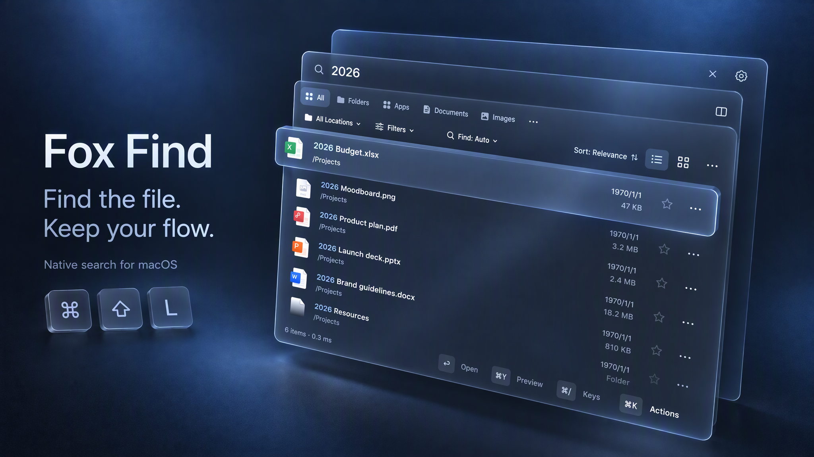
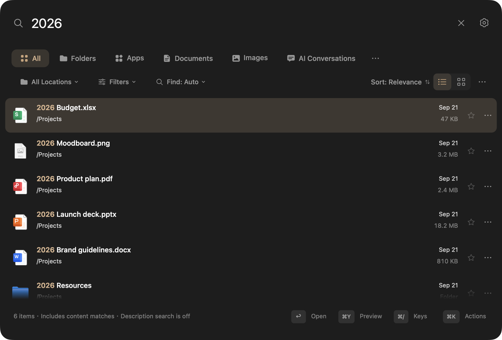
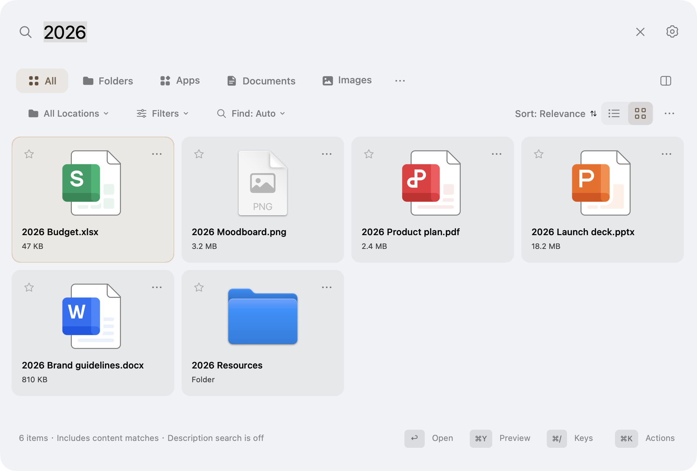
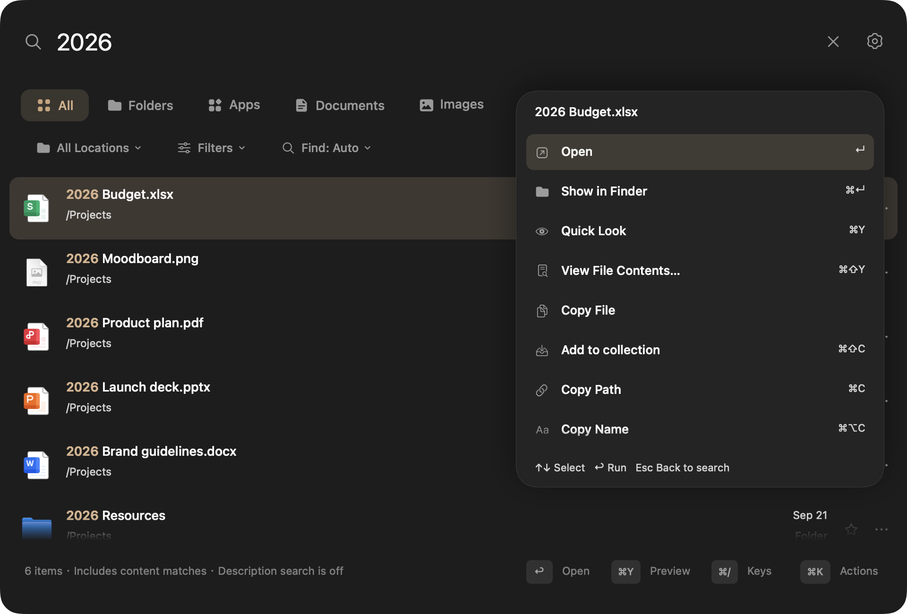
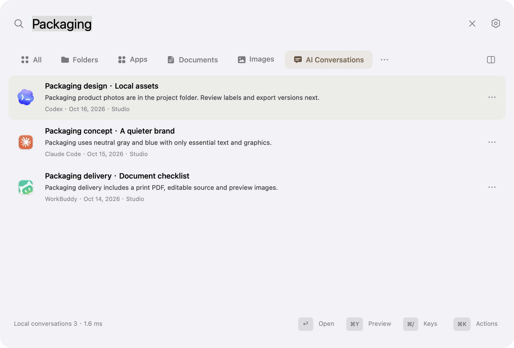

<p align="center"></p>
<h1 align="center">Fox Find</h1>
<p align="center"><strong>Find the file. Keep your flow.</strong><br>Native Mac search for filenames, document text, and words inside images.</p>
<p align="center"><a href="docs/validation/2026-10-17-0.0.1-acceptance.md">0.0.1 acceptance</a> · <a href="docs/GETTING-STARTED.md">Get started</a> · <a href="README.zh-CN.md">简体中文</a> · <a href="SUPPORT.md">Support the project</a></p>
<p align="center">macOS 14+ · Apple silicon · MIT source · 0.0.1 candidate</p>


<p align="center"><sub>Product illustration based on the native interface, using fictional sample files.</sub></p>

Press **⌘⇧L**, type, preview, open. Fox Find combines a filename index with optional
local OCR and document-content indexing. No account or paid activation is required.

## One search, a few useful ways to find things

| You remember… | Try… |
| --- | --- |
| Part of a filename | Type it, use pinyin initials, or filter with `ext:pdf` and `size:>10mb`. |
| Words in a document or screenshot | Add its folder to **Content Search**, wait for indexing, then search its words. |
| A photo's folder or date | Use folder/type/date filters. Chinese phrases such as `下载目录最近7天拍摄图片` become visible, removable conditions. Capture-date filtering needs readable photo metadata. |
| What an image looks like | Enable **Local semantic search · Experimental**, download the model and index a folder; describe the image or use **Find Similar Images**. Relevance varies. |
| An app you want to open | Search its name, or select Apps. |
| Something discussed with an AI tool | Enable **Local AI Conversations** in Settings, then select **AI Conversations**. Search local Codex, Claude Code or WorkBuddy records, preview/copy their text, or open the source conversation. |
| A quick calculation | Enter `128*1.2` or a supported unit conversion. |

Local build 35 recognizes Chinese queries such as `八月图片` and `八月的图片` as images **modified in August, across all years**; the condition chip states the date basis. `八月拍摄的图片` explicitly uses capture dates, without substituting modification dates when capture metadata is missing. Modification-date queries use the existing index without opening each image.

Chinese combinations such as `7月微信图片或视频，不超过2MB` and `大于10MB的PDF，不要合同` now keep type, indexed modification date, size and text exclusions together. WeChat filtering uses filename/path evidence, not message receipt time. Exact filenames and IDs skip embedding; unsupported conditions remain visible instead of silently disappearing. [Coverage and validation](docs/validation/2026-10-18-natural-combinations-build35.md).

- **Stay at the keyboard.** Quick Look, Finder reveal, drag and drop, favorites, saved searches and a **⌘K** action menu.
- **Choose your view.** List or thumbnail grid, dark/light appearance and custom accent colors. Sorting is separate from the filename/content matching mode.
- **Remember external drives.** Keep an offline catalog; reconnect the drive to open its files. Offline content depends on what was indexed while connected.
- **Keep content local.** OCR, extraction and optional embeddings run on your Mac. Content indexing is limited to folders you choose.

## See it in use

Native 0.8.6 build 26 screenshots with fictional files and paths.



| Light grid · full-color file icons | File actions · pointer and keyboard |
| --- | --- |
|  |  |

Local conversation search, 0.0.1 build 29 candidate, using fictional conversations:



See [build 29 validation and remaining acceptance work](docs/validation/2026-10-17-ai-search-build29.md).

## Measured responsiveness

The measurements below are historical microbenchmarks from the withdrawn 0.8.6 build. They did not cover background indexing memory pressure. Current fixes and end-to-end checks are recorded in the [0.0.1 acceptance report](docs/validation/2026-10-17-0.0.1-acceptance.md).

Apple M1 Pro · 16 GB · macOS 27.0.1. Fixed synthetic workloads, 0.8.6 build 26, Debug configuration:

| Workload | Result |
| --- | ---: |
| 300,000 filenames, exact sample query `README-000003` | P95 **8.26 ms** |
| 300,000-result scrolling, list / grid main-thread work | P95 **3.38 / 9.79 ms** |
| All 12 thumbnails, 4032 × 3024 JPEGs | **44.34 ms** |
| Reuse the same thumbnails after scrolling | **0.54 ms** |

The same thumbnail script previously recorded 190.30 ms before optimization; this run took 44.34 ms, about **77% less time**.
Broad queries cost more: `Product` returning 50,000 matches measured 30.39 ms P95; `ext:pdf` returning 50,000 measured 133.80 ms.
These are local, memory-resident-index measurements. Search timings exclude initial indexing, input debounce, OCR and semantic inference; scroll timings are not display FPS.
[Full data, historical baseline and reproduction commands](docs/PERFORMANCE.md).

## Download and install

Public downloads are paused. The repository is private and previous releases are drafts while 0.0.1 completes local acceptance. No new release has been published.

For an approved local candidate:

1. Obtain the tested app ZIP from the maintainer.
2. Unzip and move **Fox Find.app** to Applications. Open it and press **⌘⇧L**.
3. Allow the folders you want searched. Filename search works separately from content search; add a content folder in Settings for OCR/text results.

**Distribution:** this build is ad-hoc signed, **not Apple-notarized**.
macOS may block the first launch. Read [Apple's guidance](https://support.apple.com/en-us/102445)
before deciding whether to open it, or build from source. SHA-256 checksums detect
download corruption; they are not a substitute for notarization.

Apple silicon only. The deployment target is macOS 14; release testing was done
on macOS 27.0.1, not yet across older macOS versions or other Macs.
See [release validation and known limits](docs/RELEASE-0.8.6.md).

## A few shortcuts

| Shortcut | Action |
| --- | --- |
| **⌘⇧L** | Show search (configurable) |
| **Return / ⌘Return** | Open / reveal in Finder |
| **⌘Y** | Quick Look |
| **⌘K** | Actions for the selected result |
| **⌘⇧Y** | Open a reported PDF match page, or view extracted text when available |
| **⌘/** | Keyboard and search-syntax help |

Right-click any result for the same file actions. See the [getting-started guide](docs/GETTING-STARTED.md).

## Privacy and honest limits

No analytics SDK or cloud inference is included. Optional model downloads connect
to Hugging Face and its CDN. Opening a bookmark or web result opens your browser.
From 0.8.6, the app checks GitHub Releases daily for signed updates; this can be
disabled in Settings. Downloading and restarting require your click. No license-check
service is enabled. See [updates](docs/UPDATES.md).

The local database contains **unencrypted extracted text**, protected by user-only
filesystem permissions, not a separate password. See [privacy](PRIVACY.md).

Semantic search is opt-in and experimental: it needs a separate ~865 MB model
download and indexed content folders. It cannot search unindexed content; similarity
is not an exact match. Extraction has size/page limits. Encrypted documents,
cloud-only placeholders and some formats are unsupported. Network volumes and
Intel Macs are outside the current supported scope.

[Version changes](CHANGELOG.md)

## Build from source

Requires Apple silicon, macOS 14+, Xcode / Command Line Tools with Swift 5.10+,
Git, CMake and Ninja. The first build fetches pinned llama.cpp source; model weights
are not downloaded by the build.

```sh
git clone https://github.com/Livindesign/fox-find.git
cd fox-find
bash scripts/build-llama.sh
CI=true swift test
bash scripts/build-app.sh
open 'build/release/Fox Find.app'
```

See [development](docs/DEVELOPMENT.md) for packaging, test scope and module layout.
The website is maintained separately and is not included in this source tree.

## Help it get better

Report a reproducible issue, test an older macOS version, improve a translation,
or contribute a focused pull request. [Contribution guide](CONTRIBUTING.md) ·
[Roadmap](docs/ROADMAP.md) · [Security](SECURITY.md).

If Fox Find is useful, a genuine star or a short demo helps others discover it.
Financial support is optional; **no payment destination is enabled yet**.
See [Support](SUPPORT.md) for the sponsorship policy and ways to help today.

## Open-source credits

Thank you to [Oil Find](https://github.com/oil-oil/oil-find),
[DigUp](https://github.com/ARahim3/DigUp), [llama.cpp](https://github.com/ggml-org/llama.cpp)
and their contributors for the foundations and tools that help make Fox Find possible.
Fox Find is independently maintained by Livindesign and contributors.

[MIT License](LICENSE) · [Acknowledgments and origins](NOTICE.md) · [Component licenses](THIRD-PARTY-NOTICES.md)
