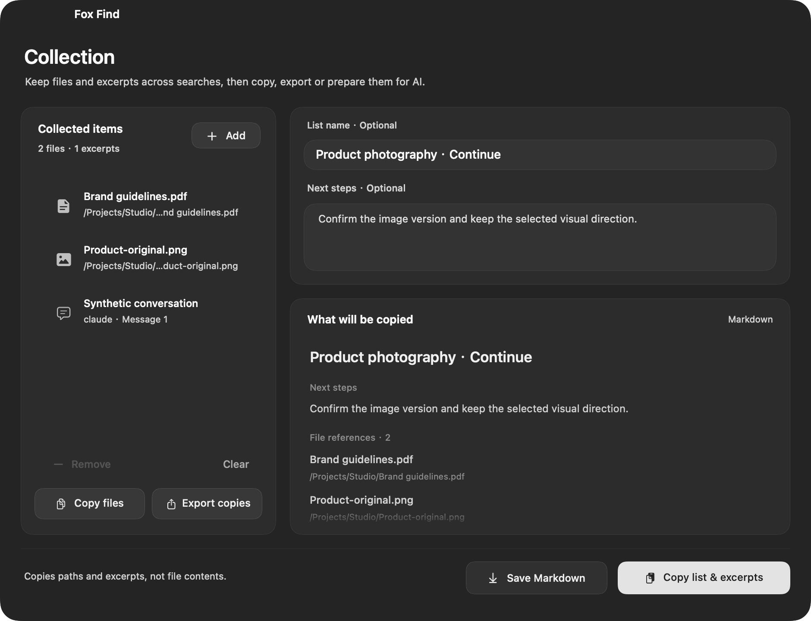

<p align="center"></p>
<h1 align="center">Fox Find</h1>
<p align="center"><strong>Find your files. Rediscover your AI conversations.</strong><br>Search filenames, words inside screenshots and documents, and local AI conversations on your Mac.</p>
<p align="center"><a href="#download">Download</a> · <a href="#in-use">See it in use</a> · <a href="docs/GETTING-STARTED.md">Get started</a> · <a href="README.zh-CN.md">简体中文</a></p>
<p align="center">Native macOS · Apple silicon · Local processing · MIT source<br><sub>0.0.1 · build 42 — first public test release. Feedback welcome.</sub></p>


<p align="center"><sub>Product illustration based on the native interface. Actual app screenshots appear below.</sub></p>

Remember a phrase, a filename, or something you discussed with an AI tool?
Press **⌘⇧L** and pick up where you left off. No account or paid activation is required.

| What you want to do | How Fox Find helps |
| --- | --- |
| **Find a file whose name you forgot** | Search words inside indexed screenshots, PDFs and documents, or narrow results by name, folder and type. |
| **Find something you discussed with AI** | Search local Codex, Claude Code and WorkBuddy records; preview and copy the conversation text. |
| **Gather material for your next task** | Collect results across searches and export their paths and selected excerpts in one list. |

<a id="download"></a>

## Try Fox Find

**[Download Fox Find 0.0.1 · Apple silicon ZIP](https://github.com/Livindesign/fox-find/releases/download/v0.0.1/Fox-Find-0.0.1-macOS-arm64.zip)**

This is the first public test release, **build 42**. [All releases and checksums](https://github.com/Livindesign/fox-find/releases)
· [Known limits and validation scope](docs/validation/2026-10-20-release-readiness-build41.md)
· [Report a problem](https://github.com/Livindesign/fox-find/issues/new/choose).

1. Unzip it and move **Fox Find.app** to Applications. Open it and press **⌘⇧L**.
2. Try a filename first. For words inside files, add a folder in **Settings → Content Search** and let indexing finish.
3. To search local conversations, enable **Local AI Conversations** in Settings and select **AI Conversations**.

Apple silicon only; macOS 14 is the deployment target. This build was tested on
macOS 27.0.1, with other Macs and older systems still to be checked. It is ad-hoc signed,
**not Apple-notarized**; macOS may block the first launch. See [Apple's guidance](https://support.apple.com/en-us/102445)
and the [getting-started guide](docs/GETTING-STARTED.md).

<a id="in-use"></a>

## Three ways to get back to work

### Find the file

Type part of a name, use pinyin initials, or search a phrase inside an indexed document
or screenshot. Select a result, preview it with **⌘Y**, then open it with **Return**.
Content search works after you add a folder and indexing finishes.


### Rediscover the conversation

Search the local records you enabled, read the matching text and copy what you need.
Supported desktop conversations can open in their source app; CLI records can provide
a resume command. Availability depends on the source and installed client version.
See [conversation setup and limits](docs/GETTING-STARTED.md).


### Bring the useful pieces together

Add a file with **⌘⇧C**, keep searching, then open the collection with **⌘⇧B**.
Export a list of file paths and selected excerpts for your project or next AI conversation.
Originals stay in place; the export does not attach full file contents automatically.



All screenshots above are native 0.0.1 build 41 renders with fictional files, paths and
conversations. They contain no personal search results. [Asset details](docs/assets/README.md).

<details>
<summary>More interface views: thumbnail grid and file actions</summary>

| Light grid · full-color file icons | Actions · pointer and keyboard |
| --- | --- |
|  |  |

List/grid views, dark/light appearance and custom accents are available.
Right-click a result or press **⌘K** for its available actions.

</details>

## A few shortcuts

| Shortcut | Action |
| --- | --- |
| **⌘⇧L** | Show search (configurable) |
| **Return / ⌘Return** | Open / reveal in Finder |
| **⌘Y / Space** | Preview; press again to close (Space when browsing results) |
| **⌘K** | Actions for the selected result |
| **⌘⇧C / ⌘⇧B** | Add selected file to collection / open collection |
| **⌘⇧Y** | Open a reported PDF match page, or view extracted text when available |
| **⌘/** | Keyboard and search-syntax help |

<details>
<summary>More ways to search: filters, dates, similar images and external drives</summary>

- **Precise conditions:** combine filename/ID text with filters such as `ext:pdf` and `size:>10mb`. Sorting is separate from the filename/content matching mode.
- **Chinese date phrases:** `八月图片` and `八月的图片` mean images modified in August, across all years. The condition chip shows the date basis. `八月拍摄的图片` uses capture dates and requires readable photo metadata; modification dates do not replace missing capture dates.
- **Combined conditions:** `7月微信图片或视频，不超过2MB` and `大于10MB的PDF，不要合同` keep type, indexed modification date, size and text exclusions together. WeChat uses filename/path evidence, not message receipt time. Unsupported conditions remain visible. [Coverage](docs/validation/2026-10-18-natural-combinations-build35.md).
- **Similar images · Experimental:** opt in to local semantic search, download its ~865 MB model and index a folder. Describe an image or use **Find Similar Images**. Relevance varies; unindexed content is unavailable.
- **External drives:** keep an offline catalog and reconnect the drive to open files. Offline content depends on what was indexed while connected.
- **Everyday shortcuts:** app launching, drag and drop, favorites, saved searches, calculations such as `128*1.2` and supported unit conversions.

</details>

## Local processing, clear boundaries

OCR, document extraction and optional semantic inference run on your Mac. Content indexing
is limited to folders you choose. No analytics SDK, account requirement or cloud inference
is included. The local database holds **unencrypted extracted text** protected by user-only
filesystem permissions. [Privacy details](PRIVACY.md).

Optional model downloads use Hugging Face/CDN; update checks use GitHub and can be disabled.
Opening a web result or bookmark opens your browser. The update feed and installation behavior
are described in [updates](docs/UPDATES.md).

Extraction has file-size/page limits. Encrypted documents, cloud-only placeholders and some
formats are unsupported. Semantic search is experimental; complex natural-language conditions
and client navigation have documented limits. Network volumes and Intel Macs are outside
the current supported scope. [Current acceptance report](docs/validation/2026-10-20-release-readiness-build41.md).

<details>
<summary>Responsiveness and measurement scope</summary>

Filename/ID queries use the index directly; filter-only searches skip the semantic model.
Content work yields while you type, scroll or preview. Thumbnail work is limited to visible
items and cached, and background extraction has a shared concurrency budget.

The [build 41 report](docs/validation/2026-10-20-release-readiness-build41.md) separates passed,
skipped and outstanding checks. [Historical measurements](docs/PERFORMANCE.md) include their
hardware and workload; they are not a large-library guarantee or a comparison with Finder.

</details>

## Help keep Fox Find useful

If Fox Find helped you find something, a star or a short demo helps others discover it.
You can also [report a reproducible issue or contribute](CONTRIBUTING.md), test another
macOS version or improve a translation.

If Fox Find saved you a little searching, [buy me a coffee on Afdian](https://afdian.com/a/livindesign).
The plan is **¥9.9/month**; select one month to support once. Afdian's official FAQ
states there is no automatic renewal. Sponsorship is optional and supports maintenance,
compatibility testing and documentation. [Support details / 支持说明](SUPPORT.md).

<a id="build"></a>

<details>
<summary>Build from source</summary>

Requires Apple silicon, macOS 14+, Xcode / Command Line Tools with Swift 5.10+,
Git, CMake and Ninja. The first build fetches pinned llama.cpp source; model weights
are not downloaded by the build.

```sh
git clone https://github.com/Livindesign/fox-find.git
cd fox-find
source scripts/swift-environment.sh
bash scripts/build-llama.sh
CI=true swift test --jobs 1
bash scripts/build-app.sh
open 'build/release/Fox Find.app'
```

See [development](docs/DEVELOPMENT.md) for packaging and module layout.
The website is maintained separately and is not included in this source tree.

</details>

[Version changes](CHANGELOG.md) · [Roadmap](docs/ROADMAP.md) · [Security](SECURITY.md)

## Open-source credits

Thank you to [Oil Find](https://github.com/oil-oil/oil-find),
[DigUp](https://github.com/ARahim3/DigUp), [llama.cpp](https://github.com/ggml-org/llama.cpp)
and their contributors for the foundations and tools that help make Fox Find possible.
Fox Find is independently maintained by Livindesign and contributors.

[MIT License](LICENSE) · [Acknowledgments and origins](NOTICE.md) · [Component licenses](THIRD-PARTY-NOTICES.md)
