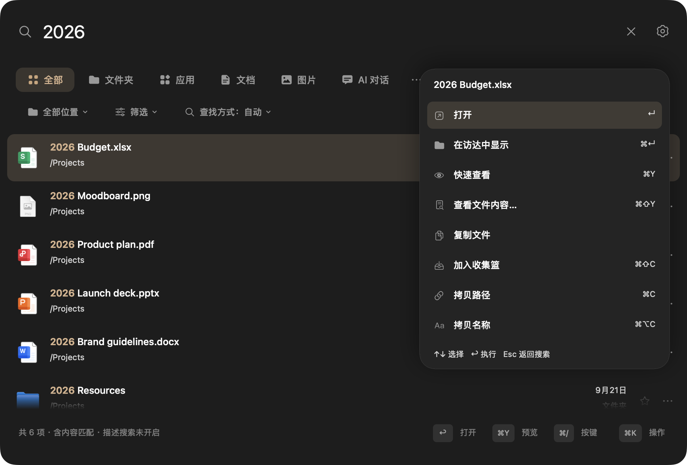

<p align="center"></p>
<h1 align="center">Fox Find</h1>
<p align="center"><strong>找到文件，接着做事。</strong><br>在 Mac 上搜索文件名、文档内容和图片里的文字。</p>
<p align="center"><a href="docs/validation/2026-10-17-0.0.1-acceptance.md">0.0.1 验收</a> · <a href="docs/GETTING-STARTED.zh-CN.md">开始使用</a> · <a href="README.md">English</a> · <a href="SUPPORT.md">支持项目</a></p>
<p align="center">macOS 14+ · Apple 芯片 · MIT 源码 · 0.0.1 待验收</p>


<p align="center"><sub>基于原生界面的产品设计图，使用虚构示例文件。</sub></p>

按 **⌘⇧L** 唤出搜索，输入、预览、打开。Fox Find 将文件名索引与可选的本地 OCR、
文档内容索引放在同一个窗口里，不需要注册账号或付费激活。

## 记得一点线索，就从这里找

| 你记得什么 | 怎么找 |
| --- | --- |
| 文件名的一部分 | 直接输入，支持拼音和首字母，也可用 `ext:pdf`、`size:>10mb` 等条件。 |
| 文档或截图里的一句话 | 在设置的「内容搜索」中添加文件夹，等索引建立后搜索其中的文字。 |
| 图片的位置或拍摄时间 | 选择目录、类型和日期，或输入 `下载目录最近7天拍摄图片`；识别出的条件可查看和删除。拍摄日期需要图片有可读取的元数据。 |
| 图片大概长什么样 | 开启「本地语义搜索 · 实验功能」、下载模型并建立文件夹索引，再输入描述，或对参考图使用「找相似图片」。相关性因素材而异。 |
| 要打开的应用 | 输入应用名，或切换到「应用」。 |
| 要算一个数 | 输入 `128*1.2`，也支持部分单位换算。 |

- **键盘优先：** Quick Look、在 Finder 中显示、拖放、收藏、保存搜索，以及 **⌘K** 文件操作菜单。
- **界面轻一些：** 列表/网格、深浅色和自定义配色。「查找方式」决定搜索哪里，排序是独立设置。
- **外置盘也记得：** 保留离线目录，接回硬盘后打开文件；离线内容取决于连接时已建立的索引。
- **内容在本机处理：** OCR、文档提取、可选语义计算都在 Mac 上完成，内容搜索只处理你添加的目录。

## 看看界面

以下为 0.8.6 build 26 原生界面的演示截图，文件与路径均为虚构示例。


| 浅色宫格 · 彩色文件图标 | 文件操作 · 鼠标与键盘均可用 |
| --- | --- |
|  |  |

## 效率，用数据说话

以下为已撤回的 0.8.6 历史微基准，未覆盖后台索引引起的内存压力。当前修复与完整流程复测见 [0.0.1 验收记录](docs/validation/2026-10-17-0.0.1-acceptance.md)。

Apple M1 Pro · 16 GB · macOS 27.0.1，0.8.6 build 26 的 Debug 构建，固定演示样本实测：

| 场景 | 结果 |
| --- | ---: |
| 30 万文件名，精确示例查询 `README-000003` | P95 **8.26 ms** |
| 30 万条结果滚动，列表 / 宫格主线程处理 | P95 **3.38 / 9.79 ms** |
| 12 张 4032 × 3024 JPEG，全部缩略图显示 | **44.34 ms** |
| 同批缩略图滚动后复用缓存 | **0.54 ms** |

同一缩略图脚本的优化前历史记录为 190.30 ms，本次为 44.34 ms，耗时减少约 **77%**。
宽泛查询会花更多时间：`Product` 返回 5 万项的 P95 为 30.39 ms；`ext:pdf` 返回 5 万项为 133.80 ms。
这些是索引已在内存中的本机测量，搜索计时不含首次索引、输入防抖、OCR 或语义推理；滚动数值不是屏幕帧率。
[完整数据、历史基线与复测方法](docs/PERFORMANCE.md)。

## 下载与安装

已暂停公开下载：仓库转为私有，已有 Release 撤回草稿；0.0.1 正在本地验收，尚未发布。

使用已通过检查的本地候选包时：

1. 从维护者获取已验收的应用 ZIP。
2. 解压，将 **Fox Find.app** 拖到「应用程序」，打开后按 **⌘⇧L**。
3. 按需允许目录访问。文件名与内容分别建立索引；要找图片文字或文档内容，还需在设置里添加内容文件夹。

**目前为 ad-hoc 签名，没有 Apple 公证。** 首次打开可能被 macOS 拦截，
请先阅读 [Apple 的应用安全说明](https://support.apple.com/zh-cn/102445)，再自行决定是否
允许打开，也可从源码构建。SHA-256 校验下载完整性，不能替代公证。

仅面向 Apple 芯片；最低部署目标为 macOS 14。本次验证环境是 macOS 27.0.1，尚未完成
其他 Mac 和较早 macOS 的兼容验证。详见 [发布验证与限制](docs/RELEASE-0.8.6.md)。

## 常用按键

| 按键 | 功能 |
| --- | --- |
| **⌘⇧L** | 唤出搜索，可在设置更改 |
| **Return / ⌘Return** | 打开 / 在 Finder 中显示 |
| **⌘Y** | 快速预览 |
| **⌘K** | 当前文件的操作菜单 |
| **⌘⇧Y** | 打开 PDF 中对应的内容页；其他可用结果显示识别文字 |
| **⌘/** | 按键与搜索语法说明 |

右键也能找到文件操作。[使用指南](docs/GETTING-STARTED.zh-CN.md) 说明索引、相似图片和无结果排查。

## 隐私与当前边界

没有集成统计 SDK 或云端推理。手动下载模型会连接 Hugging Face/CDN；主动打开网页结果
或书签时会唤起浏览器。0.8.6 起每天通过 GitHub Releases 检查签名更新，可在设置关闭；
点击后才下载并重启安装。没有授权验证服务。详见 [更新说明](docs/UPDATES.md)。

本地数据库保存 **未加密的提取文字**，使用当前用户专属的文件权限保护，不另设密码。
详见 [隐私说明](PRIVACY.md)。

语义搜索默认关闭，需要约 **865 MB** 模型及已建立索引的内容文件夹。相近内容不等于精确匹配，
未索引的内容不会被搜到。文档提取有大小和页数上限；加密文件、尚未下载的云文件及部分格式不支持。
网络卷和 Intel Mac 不在当前支持范围。

[版本更新记录](CHANGELOG.md)

## 从源码构建

需要 Apple 芯片 Mac、macOS 14+、Swift 5.10+ 的 Xcode/命令行工具、Git、CMake 和 Ninja。
首次构建会获取固定版本的 llama.cpp 源码，不会下载模型权重。

```sh
git clone https://github.com/Livindesign/fox-find.git
cd fox-find
bash scripts/build-llama.sh
CI=true swift test
bash scripts/build-app.sh
open 'build/release/Fox Find.app'
```

[开发文档](docs/DEVELOPMENT.md) · [贡献指南](CONTRIBUTING.md) · [路线图](docs/ROADMAP.md)。

## 一起打磨 Fox Find

欢迎分享使用体验、提交问题、改进翻译或参与开发。觉得好用，也欢迎 Star，让更多人发现它。
赞助入口准备中；你也可以先看看[支持方式](SUPPORT.md)。

## 开源致谢

感谢 [Oil Find](https://github.com/oil-oil/oil-find)、[DigUp](https://github.com/ARahim3/DigUp)、
[llama.cpp](https://github.com/ggml-org/llama.cpp) 及其贡献者提供的基础与工具。
Fox Find 由 Livindesign 与贡献者独立维护，持续打磨 Mac 上的搜索体验。

[MIT 许可](LICENSE) · [致谢与项目来源](NOTICE.md) · [组件许可](THIRD-PARTY-NOTICES.md)
