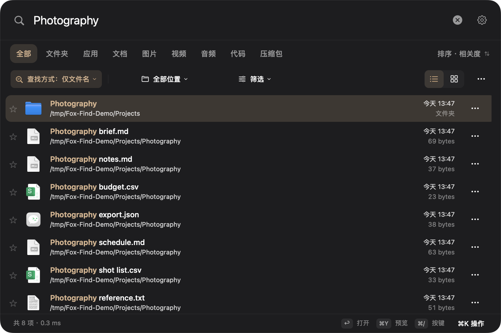

<p align="center"></p>
<h1 align="center">Fox Find</h1>
<p align="center"><strong>找到文件，接着做事。</strong><br>在 Mac 上搜索文件名、文档内容和图片里的文字。</p>
<p align="center"><a href="https://github.com/Livindesign/fox-find/releases/tag/v0.8.3-preview.1">下载预览版</a> · <a href="docs/GETTING-STARTED.zh-CN.md">开始使用</a> · <a href="README.md">English</a> · <a href="SUPPORT.md">支持项目</a></p>
<p align="center">macOS 14+ · Apple 芯片 · MIT 源码 · 0.8.3 预览版</p>


<p align="center"><sub>真实应用渲染，使用虚构示例文件，不包含个人文件。</sub></p>

按 **⌘⇧L** 唤出搜索，输入、预览、打开。Fox Find 将文件名索引与可选的本地 OCR、
文档内容索引放在同一个窗口里，不需要注册账号或付费激活。

**基于 [Oil Find 的 MIT 开源核心](https://github.com/oil-oil/oil-find) 独立维护。**
内容搜索与界面改动属于本分支；部分语义运行时代码改编自
[DigUp](https://github.com/ARahim3/DigUp)。来源和改动范围见 [鸣谢与溯源](NOTICE.md)。

## 记得一点线索，就从这里找

| 你记得什么 | 怎么找 |
| --- | --- |
| 文件名的一部分 | 直接输入，支持拼音和首字母，也可用 `ext:pdf`、`size:>10mb` 等条件。 |
| 文档或截图里的一句话 | 在设置的「内容搜索」中添加文件夹，等索引建立后搜索其中的文字。 |
| 图片的位置或拍摄时间 | 选择目录、类型和日期，或输入 `下载目录最近7天拍摄图片`；识别出的条件可查看和删除。拍摄日期需要图片有可读取的元数据。 |
| 图片大概长什么样 | 开启「本地语义搜索 · 实验功能」、下载模型并建立文件夹索引，再输入描述，或对参考图使用「找相似图片」。相关性因素材而异。 |
| 要打开的应用 | 输入应用名，或切换到「应用」。 |
| 要算一个数 | 输入 `128*1.2`，也支持部分单位换算。 |

- **键盘优先：** Quick Look、在 Finder 中显示、拖放、收藏、保存搜索，以及 **⌘K** 文件操作菜单。
- **界面轻一些：** 列表/网格、深浅色和自定义配色。「查找方式」决定搜索哪里，排序是独立设置。
- **外置盘也记得：** 保留离线目录，接回硬盘后打开文件；离线内容取决于连接时已建立的索引。
- **内容在本机处理：** OCR、文档提取、可选语义计算都在 Mac 上完成，内容搜索只处理你添加的目录。

## 安装预览版

1. 在 [Releases](https://github.com/Livindesign/fox-find/releases/tag/v0.8.3-preview.1) 下载 `Fox-Find-0.8.3-preview.1-macOS-arm64.zip`。
2. 解压，将 **Fox Find.app** 拖到「应用程序」，打开后按 **⌘⇧L**。
3. 按需允许目录访问。文件名与内容分别建立索引；要找图片文字或文档内容，还需在设置里添加内容文件夹。

**这是预览版：目前为 ad-hoc 签名，没有 Apple 公证。** 首次打开可能被 macOS 拦截，
请先阅读 [Apple 的应用安全说明](https://support.apple.com/zh-cn/102445)，再自行决定是否
允许打开，也可从源码构建。SHA-256 校验下载完整性，不能替代公证。

仅面向 Apple 芯片；最低部署目标为 macOS 14。本次验证环境是 macOS 27.0.1，尚未完成
其他 Mac 和较早 macOS 的兼容验证。详见 [发布验证与限制](docs/RELEASE-0.8.3.md)。

## 常用按键

| 按键 | 功能 |
| --- | --- |
| **⌘⇧L** | 唤出搜索，可在设置更改 |
| **Return / ⌘Return** | 打开 / 在 Finder 中显示 |
| **⌘Y** | 快速预览 |
| **⌘K** | 当前文件的可搜索操作菜单 |
| **⌘⇧Y** | 打开已标注的 PDF 命中页；其他可用结果显示识别文字 |
| **⌘/** | 按键与搜索语法说明 |

右键也能找到文件操作。[使用指南](docs/GETTING-STARTED.zh-CN.md) 说明索引、相似图片和无结果排查。

## 隐私与当前边界

没有集成统计 SDK 或云端推理。手动下载模型会连接 Hugging Face/CDN；主动打开网页结果
或书签时会唤起浏览器。没有启用自动更新或授权验证服务。

本地数据库保存 **未加密的提取文字**，使用当前用户专属的文件权限保护，不另设密码。
详见 [隐私说明](PRIVACY.md)。

语义搜索默认关闭，需要约 **865 MB** 模型及已建立索引的内容文件夹。相近内容不等于精确匹配，
未索引的内容不会被搜到。文档提取有大小和页数上限；加密文件、尚未下载的云文件及部分格式不支持。
网络卷和 Intel Mac 不在当前支持范围。

## 从源码构建

需要 Apple 芯片 Mac、macOS 14+、Swift 5.10+ 的 Xcode/命令行工具、Git、CMake 和 Ninja。
首次构建会获取固定版本的 llama.cpp 源码，不会下载模型权重。

```sh
git clone https://github.com/Livindesign/fox-find.git
cd fox-find
bash scripts/build-llama.sh
CI=true swift test
bash scripts/build-app.sh
open 'build/release/Fox Find.app'
```

[开发文档](docs/DEVELOPMENT.md) · [贡献指南](CONTRIBUTING.md) · [路线图](docs/ROADMAP.md)。

## 支持与鸣谢

欢迎提交可复现的问题、翻译、兼容性反馈和改进 PR。如果用得顺手，也欢迎 Star 或分享真实体验。
**收款入口暂未启用**，后续确认爱发电链接后再开通。赞助自愿，不解锁功能，不影响 MIT 许可；
支持本项目表示支持 Fox Find 分支的维护。详见 [支持说明](SUPPORT.md)。

感谢 [Oil Find](https://github.com/oil-oil/oil-find) 作者 **Lin Zhihuang** 提供 MIT 基础，
感谢 [DigUp](https://github.com/ARahim3/DigUp) 作者 **Abdur Rahim** 和
[llama.cpp](https://github.com/ggml-org/llama.cpp) 的工作。原作者版权与完整许可随源码和应用保留。

Fox Find 是独立衍生项目，与上述项目无隶属或背书关系，不包含 Oil Find Pro 私有模块或原厂二进制。
[MIT 许可](LICENSE) · [来源说明](NOTICE.md) · [第三方许可](THIRD-PARTY-NOTICES.md)。
