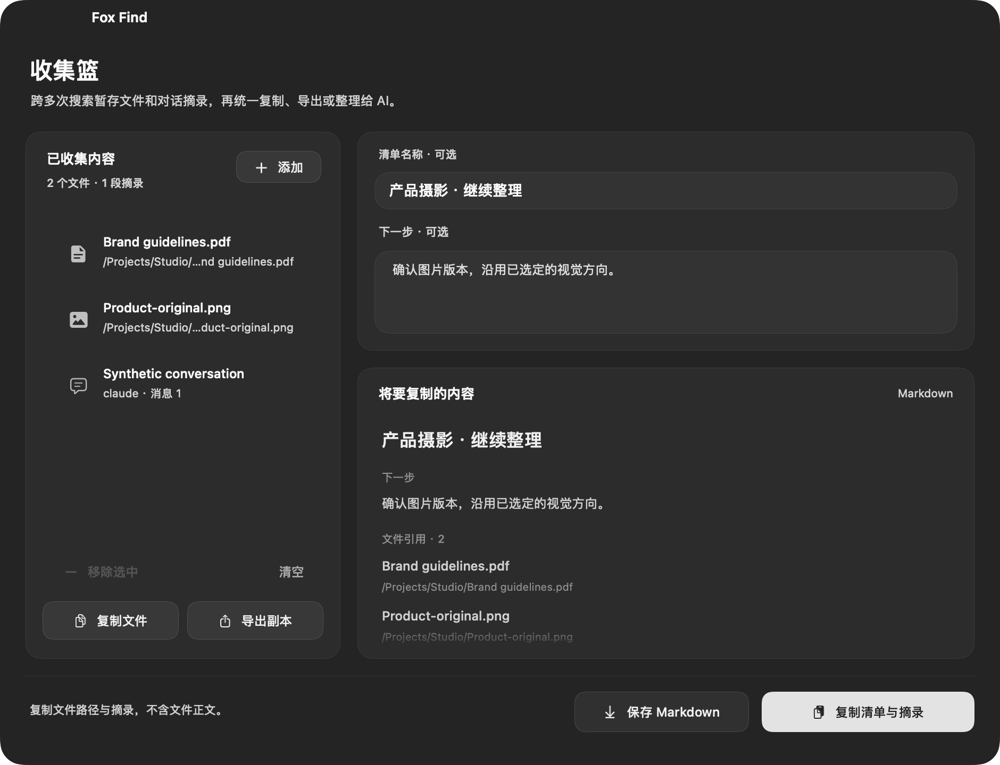

<p align="center"></p>
<h1 align="center">Fox Find</h1>
<p align="center"><strong>找回文件，也找回那段 AI 对话。</strong><br>在 Mac 上搜索文件名、截图与文档里的文字，以及本地 AI 对话。</p>
<p align="center"><a href="#download">下载</a> · <a href="#in-use">看看怎么用</a> · <a href="docs/GETTING-STARTED.zh-CN.md">开始使用</a> · <a href="README.md">English</a></p>
<p align="center">原生 macOS · Apple 芯片 · 本机处理 · MIT 源码<br><sub>0.0.1 · build 42 — 首个公开测试版本，欢迎体验与反馈。</sub></p>


<p align="center"><sub>基于原生界面的产品设计图；下方展示应用实际界面。</sub></p>

记得一句话、半个文件名，或曾经和 AI 讨论过的内容？
按 **⌘⇧L**，找到它，接着做事。无需账号，也无需付费激活。

| 你想做什么 | Fox Find 怎么帮你 |
| --- | --- |
| **忘了文件名，找回那份文件** | 搜索已索引的截图、PDF 和文档里的文字，也能按名称、目录和类型缩小范围。 |
| **忘了在哪聊过，找回那段对话** | 搜索 Codex、Claude Code、WorkBuddy 的本地记录，查看和复制原文。 |
| **资料散在各处，为下一步整理好** | 跨多次搜索收集结果，统一导出文件路径与所选摘录。 |

<a id="download"></a>

## 开始体验

**[下载 Fox Find 0.0.1 · Apple 芯片 ZIP 安装包](https://github.com/Livindesign/fox-find/releases/download/v0.0.1/Fox-Find-0.0.1-macOS-arm64.zip)**

这是首个公开测试版本，**build 42**。[版本与校验文件](https://github.com/Livindesign/fox-find/releases)
· [已知限制与验证范围](docs/validation/2026-10-20-release-readiness-build41.md)
· [反馈问题](https://github.com/Livindesign/fox-find/issues/new/choose)。

1. 解压，将 **Fox Find.app** 拖到「应用程序」，打开后按 **⌘⇧L**。
2. 先试一个文件名。要搜文件里的文字，请在「设置 → 内容搜索」添加文件夹，等待索引完成。
3. 要搜本地对话，在设置开启「本地 AI 对话搜索」，然后切换到「AI 对话」。

仅面向 Apple 芯片，最低部署目标为 macOS 14。本次验证环境是 macOS 27.0.1，其他 Mac
和较早系统仍待验证。目前为 ad-hoc 签名，**尚未完成 Apple 公证**，首次打开可能被系统拦截。
详见 [Apple 安全说明](https://support.apple.com/zh-cn/102445)和[使用指南](docs/GETTING-STARTED.zh-CN.md)。

<a id="in-use"></a>

## 三种场景，接着把事情做完

### 找回那份文件

输入文件名的一部分、拼音首字母，或已索引文档、截图中的一句话。
选中结果，按 **⌘Y** 预览，再按 **Return** 打开。
内容搜索需要先添加文件夹，并完成索引。


### 找回那段对话

在已开启的本地记录里搜索，读到匹配原文，复制需要的内容。
支持的桌面会话可以回到原客户端；CLI 记录可提供继续命令。
具体能力取决于对话来源和客户端版本，详见[对话设置与边界](docs/GETTING-STARTED.zh-CN.md)。


### 把有用的材料放到一起

按 **⌘⇧C** 加入文件，接着搜索，再按 **⌘⇧B** 打开收集篮。
导出路径清单和所选摘录，用于项目整理或下一次 AI 对话。
原文件保留在原位，导出时不会自动附上文件全文。



以上均为 0.0.1 build 41 的原生界面渲染，文件、路径和对话全部使用虚构示例，
不含个人搜索结果。[素材说明](docs/assets/README.md)。

<details>
<summary>更多界面：缩略图宫格与文件操作</summary>

| 浅色宫格 · 彩色文件图标 | 文件操作 · 鼠标与键盘均可用 |
| --- | --- |
|  |  |

支持列表/宫格、深浅色界面和自定义配色。
右键结果或按 **⌘K**，查看当前结果可用的操作。

</details>

## 常用按键

| 按键 | 功能 |
| --- | --- |
| **⌘⇧L** | 唤出搜索，可在设置更改 |
| **Return / ⌘Return** | 打开 / 在 Finder 中显示 |
| **⌘Y / 空格** | 预览，再按关闭；空格需先进入结果浏览状态 |
| **⌘K** | 当前结果的操作菜单 |
| **⌘⇧C / ⌘⇧B** | 将选中文件加入收集篮 / 打开收集篮 |
| **⌘⇧Y** | 打开 PDF 中对应的内容页；其他可用结果显示识别文字 |
| **⌘/** | 按键与搜索语法说明 |

<details>
<summary>更多查找方式：筛选、日期、相似图片与外置盘</summary>

- **明确条件：** 文件名、编号和 `ext:pdf`、`size:>10mb` 等筛选可组合使用。排序与「查找方式」分别设置。
- **中文日期：** `八月图片`、`八月的图片` 按所有年份的八月修改时间筛选，日期依据显示在标签中。`八月拍摄的图片` 则要求有真实拍摄日期，缺失时不会用修改时间替代。
- **组合条件：** `7月微信图片或视频，不超过2MB`、`大于10MB的PDF，不要合同` 会组合类型、索引中的修改日期、大小和文字排除。微信按文件名或路径筛选，不代表接收时间；未识别条件会提示。[覆盖范围](docs/validation/2026-10-18-natural-combinations-build35.md)。
- **相似图片 · 实验功能：** 需要主动开启本地语义搜索、下载约 865 MB 模型并为文件夹建立索引，再按描述或参考图找相似图片。相关性因素材而异，未索引的内容无法搜索。
- **外置盘：** 保留离线目录，接回硬盘后打开文件；离线内容取决于连接时已建立的索引。
- **日常操作：** 启动应用、拖放、收藏、保存搜索、`128*1.2` 等计算和部分单位换算。

</details>

## 本机处理，边界说清楚

OCR、文档提取和可选语义计算都在 Mac 上完成，内容索引只处理你选择的目录。
无需账号，没有集成统计 SDK 或云端推理。本地数据库保存**未加密的提取文字**，
通过当前用户专属文件权限保护。详见[隐私说明](PRIVACY.md)。

下载模型会连接 Hugging Face/CDN；检查更新会连接 GitHub，可在设置关闭。
打开网页结果或书签时会唤起浏览器。[更新说明](docs/UPDATES.md)介绍下载与安装行为。

文档提取有大小和页数上限，加密文档、未下载的云文件和部分格式不支持。
语义搜索为实验功能，复杂自然语言条件和客户端跳转有明确边界。
网络卷和 Intel Mac 不在当前支持范围。详见[本轮验收记录](docs/validation/2026-10-20-release-readiness-build41.md)。

<details>
<summary>响应速度与测量范围</summary>

文件名和编号直接查询索引，纯筛选跳过语义模型。输入、滚动和预览期间，后台内容处理让出资源；
缩略图按可见区域加载并复用缓存，后台提取共用并发预算。

[build 41 报告](docs/validation/2026-10-20-release-readiness-build41.md)分别列出已通过、跳过与待验收项目。
[历史测量](docs/PERFORMANCE.md)保留了机器和样本范围，不作为大文件库性能保证或与 Finder 的对比。

</details>

## 一起把 Fox Find 打磨好

如果 Fox Find 帮你找回了东西，欢迎 Star 或分享一段实际体验，让更多人发现它。
也欢迎[提交可复现的问题、参与开发](CONTRIBUTING.md)，测试其他 macOS 版本或改进翻译。

Fox Find 帮你少找了一会儿文件？[请作者喝杯咖啡](https://afdian.com/a/livindesign)。
爱发电档位为 **9.9 元/月**，支持一次可选择 1 个月，平台官方说明没有自动续费。
赞助完全自愿，用于持续维护、兼容性测试和文档完善。[支持说明 / Support details](SUPPORT.md)。

<a id="build"></a>

<details>
<summary>从源码构建</summary>

需要 Apple 芯片 Mac、macOS 14+、Swift 5.10+ 的 Xcode/命令行工具、Git、CMake 和 Ninja。
首次构建会获取固定版本的 llama.cpp 源码，不会下载模型权重。

```sh
git clone https://github.com/Livindesign/fox-find.git
cd fox-find
source scripts/swift-environment.sh
bash scripts/build-llama.sh
CI=true swift test --jobs 1
bash scripts/build-app.sh
open 'build/release/Fox Find.app'
```

[开发文档](docs/DEVELOPMENT.md)介绍打包和模块划分。
网站独立维护，不包含在这个源码仓库中。

</details>

[版本更新](CHANGELOG.md) · [路线图](docs/ROADMAP.md) · [安全问题](SECURITY.md)

## 开源致谢

感谢 [Oil Find](https://github.com/oil-oil/oil-find)、[DigUp](https://github.com/ARahim3/DigUp)、
[llama.cpp](https://github.com/ggml-org/llama.cpp) 及其贡献者提供的基础与工具。
Fox Find 由 Livindesign 与贡献者独立维护，持续打磨 Mac 上的搜索体验。

[MIT 许可](LICENSE) · [致谢与项目来源](NOTICE.md) · [组件许可](THIRD-PARTY-NOTICES.md)
